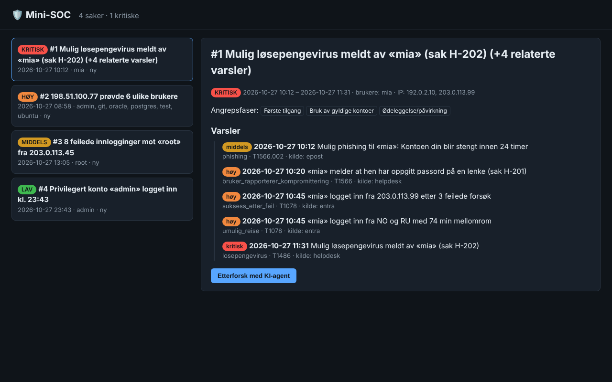

# 🛡️ Mini-SOC med KI-agent

Et lite **Security Operations Center** for småbedrifter. Mini-SOC samler hendelser fra
innlogginger, e-post og helpdesk, finner angrep med deteksjonsregler, **kobler varslene sammen
til hendelsessaker** og lar en **KI-agent (Claude) etterforske** saken med verktøy – og skrive en
hendelsesrapport på norsk.

*A small Security Operations Center: collects sign-in, e-mail and helpdesk events, detects attacks
(mapped to MITRE ATT&CK), correlates alerts into incidents and lets a Claude agent investigate with
tools. Dashboard, REST API, SQLite, Docker and an evaluation suite. Text is in Norwegian.*




## Hva den finner i eksempeldataene

Eksempeldataene er et oppdiktet angrep mot en småbedrift en vanlig tirsdag. Mini-SOC ser fem
varsler fra tre ulike kilder som **samme angrep**, og løfter det til kritisk fordi det dekker
hele angrepskjeden:

```
$ python -m mini_soc analyser eksempler
4 saker (viktigste først):

[KRITISK ] Sak 1: Mulig løsepengevirus meldt av «mia» (sak H-202) (+4 relaterte varsler)
           Faser: Første tilgang → Bruk av gyldige kontoer → Ødeleggelse/påvirkning
           10:12  T1566.002  Mulig phishing til «mia»: Kontoen din blir stengt innen 24 timer
           10:20  T1566      «mia» melder at hen har oppgitt passord på en lenke (sak H-201)
           10:45  T1078      «mia» logget inn fra 203.0.113.99 etter 3 feilede forsøk
           10:45  T1078      «mia» logget inn fra NO og RU med 74 min mellomrom
           11:31  T1486      Mulig løsepengevirus meldt av «mia» (sak H-202)

[  HØY   ] Sak 2: 198.51.100.77 prøvde 6 ulike brukere
[MIDDELS ] Sak 3: 8 feilede innlogginger mot «root» fra 203.0.113.45
[  LAV   ] Sak 4: Privilegert konto «admin» logget inn kl. 23:43
```

## Arkitektur

```
 auth.log ─┐
 Entra-CSV ─┤                                                         ┌─► CLI-rapport
 e-post ────┼─► kilder ─► Hendelser ─► regler ─► Varsler ─► korrelasjon ─► Saker ─► SQLite ─┼─► REST-API + dashboard
 helpdesk ──┘   (felles format)        (MITRE ATT&CK)     (union-find)                     └─► KI-agent ─► rapport
                                                                                                │
                                         verktøy: hent_sak · sok_hendelser · sla_opp_ip ◄───────┘
                                                  hent_bruker · skriv_notat · les_notater
```

| Del | Hva den gjør | Fil |
|---|---|---|
| Kilder | Leser sshd-logg, CSV fra Entra ID, `.eml`-filer og helpdesk-saker til ett felles format | `mini_soc/kilder/` |
| Regler | 8 regler: password spraying, brute force, innlogging etter feil, umulig reise, privilegert konto om natta, phishing, bruker melder kompromittering, løsepengevirus – alle merket med MITRE ATT&CK | `mini_soc/regler.py` |
| Korrelasjon | Kobler varsler som deler bruker eller ekstern IP innen 6 timer. Kontornettet brukes ikke som kobling. En sak som dekker 3+ angrepsfaser løftes ett alvorsnivå | `mini_soc/korrelasjon.py` |
| Lagring | SQLite med hendelser, saker, agentens notater og **revisjonslogg** | `mini_soc/lagring.py` |
| KI-agent | Claude etterforsker med 6 verktøy i en løkke (maks 12 steg) og leverer en strukturert rapport: tidslinje, MITRE, strakstiltak og varslingsplikt | `mini_soc/agent.py` |
| API og dashboard | REST-API og nettside, bare standardbiblioteket | `mini_soc/api.py`, `mini_soc/static/` |
| Evaluering | Måler presisjon og gjenfinning mot fasit, inkludert et støy-scenario for falske alarmer | `mini_soc/evaluering.py`, `eval/` |

## Sikkerhet i designet

En SOC-agent leser data som angripere har skrevet. Derfor:

- **Minste privilegium:** agenten har bare lese-verktøy og notater. Den kan ikke sperre kontoer,
  slette filer eller sende e-post – tiltak er anbefalinger som et menneske godkjenner.
- **Vern mot prompt injection:** logglinjer og e-post pakkes i `<data>`-markører, og systemprompten
  sier at innholdet aldri er instruksjoner. Ukjente verktøy avvises.
- **Dataminimering (GDPR art. 5):** telefonnumre, fødselsnumre, kortnumre og passord maskeres før
  noe sendes til modellen. IP-adresser og brukernavn beholdes fordi de trengs i etterforskningen.
- **Sporbarhet:** hvert verktøykall agenten gjør skrives til revisjonsloggen.
- **Herdet dashboard:** Content-Security-Policy, `nosniff`, og DOM bygges med `textContent`
  (ikke `innerHTML`), så data fra logger ikke kan kjøres som kode.
- **Herdet container:** kjører som vanlig bruker, skrivebeskyttet filsystem, `no-new-privileges`, og
  porten er bare åpen mot din egen maskin.

## Kom i gang

```bash
git clone https://github.com/nbrre/mini-soc.git
cd mini-soc
python -m mini_soc analyser eksempler          # ingen installasjon eller API-nøkkel trengs
python -m mini_soc eval                        # treffsikkerhet mot fasit
python -m mini_soc server eksempler            # dashboard på http://127.0.0.1:8000
```

KI-agenten trenger en API-nøkkel fra [console.anthropic.com](https://console.anthropic.com):

```bash
pip install -r requirements.txt
export ANTHROPIC_API_KEY=sk-ant-...            # Windows PowerShell: $env:ANTHROPIC_API_KEY="sk-ant-..."
python -m mini_soc etterforsk eksempler --sak 1
```

Med Docker:

```bash
docker compose up --build                      # dashboard på http://127.0.0.1:8000
```

## Tester og evaluering

```bash
python -m unittest -v      # 16 tester, uten internett og uten API-nøkkel
python -m mini_soc eval    # presisjon og gjenfinning per scenario
```

KI-agenten testes med en falsk Claude-klient som spiller av et fast manus med verktøykall. Testene
sjekker blant annet at telefonnummeret faktisk er fjernet før data sendes til modellen, at
logger er merket som data, at hvert steg havner i revisjonsloggen, og at agenten tvinges til å
levere rapport på siste steg. GitHub Actions kjører tester og evaluering ved hver push.

## Videre arbeid

- Lese direkte fra Microsoft Graph (Entra-innlogginger) og Microsoft Defender
- Flere regler (f.eks. nye videresendingsregler i e-post, MFA-tretthet)
- Evaluere agentens rapporter mot fasit med en egen vurderingsmodell
- Varsling til Teams/Slack når en kritisk sak oppstår

Alle personer, firmaer og hendelser i eksempeldataene er oppdiktet. IP-adressene er fra områder
reservert for dokumentasjon (192.0.2.0/24, 198.51.100.0/24, 203.0.113.0/24).

## Om meg

Laget av **Barre**, bachelor i informasjonsteknologi/informasjonssikkerhet.

Lisens: MIT
